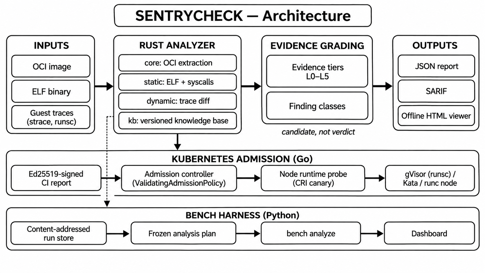
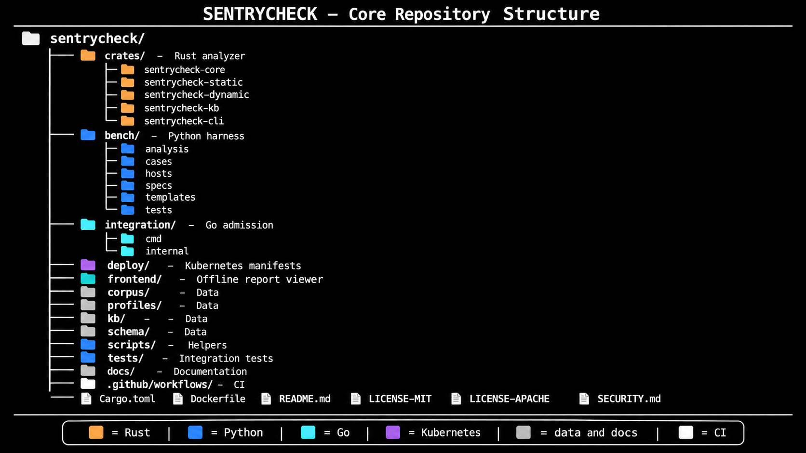
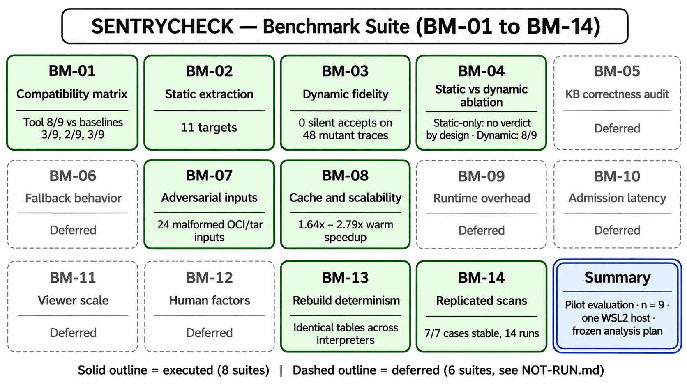

## Overview

SENTRYCHECK predicts whether a container workload will run correctly under a restricted runtime such as gVisor or Kata Containers.

- Analyzes OCI images, ELF binaries and execution traces
- Compares native and sandboxed runs
- Grades every finding by evidence tier
- Reports a syscall reference as an unconfirmed capability candidate, never as a compatibility verdict

## Key Features

**Analysis**
- **Static analysis:** ELF parsing and syscall candidate extraction; works on any operating system
- **Dynamic analysis:** `strace` and `runsc` trace parsing, with native-versus-sandbox trace diffing and evidence capture
- **OCI image extraction:** unpacks image layouts and analyzes the binaries inside
- **Versioned knowledge base:** compatibility rules pinned to a runtime release (gVisor `20260921.0`), with KB diffing between versions
- **Stale-KB protection:** a knowledge base older than 30 days downgrades findings to `indeterminate`

**Evidence and findings**
- **Evidence tiers L0 to L5:** every result states how strong its support is
- **Six finding classes:** `hard-failure`, `silent-degradation`, `performance-regression`, `tolerated`, `compatible`, `indeterminate`
- **No silent guessing:** static-only scans exit with code 2 (no verdict) by design
- **Workload profiles:** per-workload TOML profiles (for example Python and Node)

**Reporting**
- **JSON report:** the full machine-readable result
- **SARIF output:** plugs into code-scanning tools
- **Offline HTML viewer:** an explorer for findings, evidence and traces that needs no network
- **Benchmark dashboard:** a standalone HTML dashboard generated from run data

**Enforcement**
- **CI gate:** `ci-gate` fails a pipeline when a finding matches `--fail-on`
- **Kubernetes admission control:** blocks pods on a missing or invalid signed report, a stored `hard-failure`, or an unhealthy node runtime
- **Ed25519-signed reports:** tamper-evident reports verified at admission
- **Node runtime probe:** a CRI canary that checks runtime health on the node
- **Multi-runtime targets:** gVisor (`runsc`), Kata Containers and `runc`

**Evaluation and reproducibility**
- **Pre-registered analysis:** a frozen plan sealed before results are computed
- **Statistics built in:** Wilson confidence intervals, exact McNemar tests and Holm correction
- **Content-addressed run store:** every run and artifact is hashed and verifiable
- **Baseline comparisons:** naive syscall table, Confine-style static reachability, and run-and-check-exit-code
- **Honest scope:** deferred suites are documented in `NOT-RUN.md`, not hidden
- **Dependency-light harness:** Python standard library only

## Architecture



| Component | Language | Role |
|---|---|---|
| Analyzer (`crates/`) | Rust | ELF and OCI analysis, trace parsing, knowledge base, CLI |
| Harness (`bench/`) | Python (standard library) | Benchmark suites, run store, analysis, dashboard |
| Admission and probe (`integration/`) | Go | Admission controller, Ed25519 verification, node probe |
| Report viewer (`frontend/`) | HTML, JavaScript | Offline explorer for findings and evidence |

### Rust crates

| Crate | Responsibility |
|---|---|
| `sentrycheck-core` | OCI extraction, report model, hashing |
| `sentrycheck-static` | ELF parsing, syscall candidate extraction |
| `sentrycheck-dynamic` | `strace` and `runsc` trace parsing, evidence capture |
| `sentrycheck-kb` | Versioned knowledge base and KB diff |
| `sentrycheck-cli` | `scan`, `ci-gate`, `report`, benchmark bridge |

## Repository Structure



## Inputs, Profiles and Schemas

- **Inputs:** OCI images, ELF binaries, and guest traces from `strace` and `runsc`
- **Profiles (`profiles/`):** TOML workload profiles that describe expected behavior
- **Schemas (`schema/`):** JSON schemas for the report, the profile and the runtime comparison
- **Corpus (`corpus/`):** workload fixtures covering synthetic cases, Go, Node and PostgreSQL
- **Knowledge base (`kb/`):** the versioned snapshot used for analysis

## Quickstart

**Requirements**

- Rust 1.82+ and Python 3.10+
- Go 1.23+ (optional)
- Linux, runc and runsc (for live scans only)

**Commands**

```bash
cargo build --release
target/release/sentrycheck scan ./program.elf --static-only   # exits 2: no verdict by design
target/release/sentrycheck scan ./image-oci --runtime gvisor --profile profiles/python.toml --output report.json
target/release/sentrycheck ci-gate ./image-oci --profile profiles/node.toml --fail-on hard-failure
target/release/sentrycheck report render report.json --output report.html
python -m bench analyze && python -m bench verify --all --prereg
```

**Exit codes**

- `0`: complete, no matching finding
- `1`: a finding matches `--fail-on`
- `2`: invalid input or incomplete evidence

## Command Reference

| Command | Purpose |
|---|---|
| `sentrycheck scan` | Analyze an image or ELF binary and write a report |
| `sentrycheck ci-gate` | Fail a pipeline when a finding matches `--fail-on` |
| `sentrycheck report render` | Render a JSON report as an HTML page |
| `sentrycheck report sarif` | Convert a JSON report to SARIF |
| `sentrycheck bench estimate` | Estimate the time and disk budget before a run |
| `sentrycheck bench suite BM-01` | Run a benchmark suite (live compatibility sweep) |
| `sentrycheck bench dashboard` | Generate the standalone HTML dashboard |
| `sentrycheck bench verify --all` | Recompute and check artifact hashes |
| `sentrycheck bench cases validate-submission` | Validate a submitted case file |

## Pilot Results

- Computed by `bench analyze` under a frozen analysis plan (`bench/analysis/preregistration.json`)
- Nine author-selected cases, one held out

| Method | Correct | Wilson 95% CI | Discordant (b, c) | McNemar p | Holm p |
|---|:---:|:---:|:---:|:---:|:---:|
| **SENTRYCHECK (dynamic diff)** | **8 / 9** | 0.565 – 0.980 | – | – | – |
| B0: naive syscall table | 3 / 9 | 0.121 – 0.646 | (5, 0) | 0.0625 | 0.1875 |
| B3: Confine-style re-implementation | 2 / 9 | 0.063 – 0.547 | (6, 0) | 0.03125 | 0.125 |
| B5: run and check exit code | 3 / 9 | 0.121 – 0.646 | (5, 0) | 0.0625 | 0.1875 |

- McNemar p is the exact two-sided test against SENTRYCHECK
- Holm correction covers four paired comparisons
- **No comparison is significant after correction**

### Limitations

- **Small sample:** with n = 9 the intervals are wide and power is low
- **Development corpus:** cases were observed during prototyping; only `postgres-18-io-uring` is held out
- **Self-authored baselines:** B3 is a re-implementation, not Confine itself
- **Single host:** WSL2 (Ubuntu 24.04 on Windows 11), no CPU governor control
- **Integrity, not correctness:** hashing detects tampering; it does not validate ground truth

## Benchmark Suites



- 8 of 14 suites executed; 6 deferred
- Prerequisites for deferred suites: `bench/specs/NOT-RUN.md`
- Per-suite runbooks: `bench/specs/`

## Robustness and Performance

- **Adversarial inputs (BM-07):** 24 malformed OCI and tar inputs handled with memory bounded under 128 MB RSS
- **Dynamic fidelity (BM-03):** 0 silent accepts on 48 mutant traces
- **Caching (BM-08):** warm scans are 1.64x to 2.79x faster across 4 targets (single run)
- **Determinism (BM-13):** identical tables and figures across Windows and WSL2 interpreters
- **Replication (BM-14):** 7/7 cases stable across 14 runs (one host, Wilson 95% CI 0.65 – 1.00)

## Reproducibility

- Every run and artifact is content-hashed; `bench verify` checks integrity and the plan seal
- Raw traces and large PostgreSQL reports (about 50 MB each) are not in git; they ship as Release assets and must be extracted into `bench/runs/` before `verify --all`
- Third-party images are referenced by pinned digest (`bench/images/pins.json`), not redistributed
- Recorded host descriptions live in `bench/hosts/`
- Private keys and `controller-config.json` must stay out of version control

## Roadmap

- [ ] BM-05 KB correctness audit (upstream audit of 200+ rules)
- [ ] BM-06 Fallback behavior (multi-tool fault injector)
- [ ] BM-09 Runtime overhead (quiet bare-metal host)
- [ ] BM-10 Admission latency (live Kubernetes cluster)
- [ ] BM-11 Viewer scale (accessibility harness)
- [ ] BM-12 Human factors (IRB approval)
- [ ] Larger evaluation across more cases, releases and hosts

## Contributing

Contributions are welcome. For major changes, open an issue first.

- Case submissions must declare an open-source license and the expected interfaces
- Submissions cannot assign themselves to the frozen `test` split
- Validate before opening a pull request:

```bash
sentrycheck bench cases validate-submission --file case.json
cargo test --workspace --locked && python -m pytest bench/tests tests -q
```

- Report vulnerabilities as described in `SECURITY.md`

## License

MIT License ([LICENSE-MIT](LICENSE-MIT)).