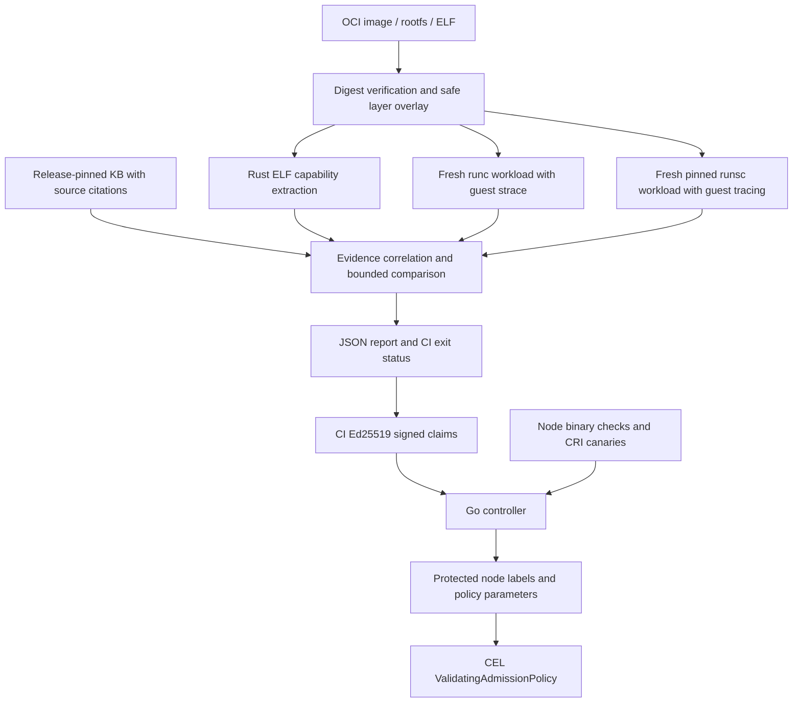

# Architecture

`sentrycheck-core` owns the report model, content hashing, safe paths, OCI metadata and layer overlay. It verifies both compressed descriptor hashes and uncompressed diff IDs. Archive paths are never blindly unpacked by tar. Runtime materialization writes regular files before symlinks and rejects symlink ancestors.

`sentrycheck-static` owns the checked ELF parser, x86 instruction decoding, conservative constant propagation, basic ARM64 patterns, metadata fingerprints, and content-addressed analysis cache. It cannot construct a compatibility Finding; its API returns a CapabilitySet only.

`sentrycheck-kb` owns exact release/architecture applicability and evidence correlation. Static matches become candidate gaps. Native-only observations become compatibility risks. Local or explicitly imported guest comparisons can establish observed failures/output differences. A native baseline failure prevents an inference that the sandbox caused the failure.

`sentrycheck-dynamic` owns profile parsing, per-run isolation, process/output bounds, native tracer injection, guest-trace parsing, imported-artifact verification, and comparison inputs. Traces carry syscall names but no reliable ELF offsets, so static sites remain un-attributed. The scanner never treats a host trace of runsc's own implementation syscalls as an application trace.

`sentrycheck-cli` assembles a report, checks KB freshness and analysis completeness, exposes source explanations, handles skopeo-based acquisition, and applies the exit contract. Runtime execution failures degrade evidence visibly. It does not contact Kubernetes or claim to verify node isolation.

The Go integration signs compact claims bound to the full report hash; full traces need not fit in a ConfigMap. A controller validates those claims, checks probe freshness, verifies RuntimeClass wiring, maintains protected node labels, and publishes bounded CEL parameters. The default policy binding warns. Strict mode is explicitly activated by installing its separate binding.

Node canaries verify the CRI-reported handler type and configured binary version. They do not assert that missing runtimes trigger standard Kubernetes fallback, nor prove every existing Pod's runtime. Controller outages and time-of-check/time-of-use drift remain limitations documented in LIMITATIONS.md.
